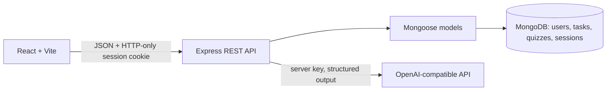

# StudyHub

StudyHub is a full-stack student workspace for organizing tasks, practising with AI generated quizzes, and tracking learning progress. It uses React and Vite, Express, MongoDB and Mongoose. Learn. Plan. Achieve.

## Features

- Private user accounts with bcrypt password hashing and MongoDB-backed HTTP-only sessions.
- Task create, edit, complete, reopen, delete, search, status filters, priority, due dates, and overdue indicators.
- AI generated multiple choice quizzes, protected answer keys, server-scored submissions, explanations, and repeat checking against each user's recent questions.
- Dashboard Focus Orbit, task summaries, quiz history, subject accuracy, and performance chart.
- Profile name and Light, Dark, or System theme preference.
- Responsive layouts, keyboard focus styles, loading, error, empty, and confirmation states.

## Requirements and setup

- Node.js 20 or newer, npm 10 or newer, MongoDB locally or an Atlas cluster.
- An OpenAI API key is needed for AI quizzes. It stays on the backend. There is no fake-question fallback: without a key, generation reports that it is unavailable.

```powershell
npm install
Copy-Item server/.env.example server/.env
# Edit server/.env with MongoDB URI and a random SESSION_SECRET (32+ characters).
npm run dev
```

The API listens on `http://localhost:5000`; Vite serves the frontend at `http://localhost:5173`. Use two terminals instead if preferred: `npm run dev -w server` and `npm run dev -w client`.

The configured local development URI is `mongodb://127.0.0.1:27017/studyhub`; it stores all app collections in the local `studyhub` database. Startup creates `users`, `tasks`, `quizzes`, and `sessions` collections and their indexes. For Atlas instead, create a database user with access only to StudyHub, allow your development/deployment network in Network Access, and intentionally replace `MONGODB_URI` with the `mongodb+srv://` connection string. Do not commit `.env` files. In deployment configure all environment variables in the hosting provider. Use HTTPS so production session cookies can be Secure.

## Environment

`server/.env.example` documents `PORT`, `NODE_ENV`, `MONGODB_URI`, `CLIENT_URL`, `SESSION_SECRET`, `AI_PROVIDER`, `AI_BASE_URL`, `AI_API_KEY`, and `AI_MODEL`. The integration uses an OpenAI-compatible Chat Completions endpoint; `AI_BASE_URL` and model can be configured for compatible providers. `VITE_API_URL` optionally overrides the browser API base (default `http://localhost:5000/api`). Use a long random secret outside development. MongoDB is required to start the server.

## Commands

```powershell
npm run dev       # API and web app
npm run build     # production frontend in client/dist
npm run lint      # ESLint on both workspaces
npm test          # server tests
```

Production: use the included [Render Blueprint](render.yaml) to deploy the frontend and API together on one HTTPS origin as `socialhub`. Set `MONGODB_URI` to a MongoDB Atlas URI using the `socialhub` database and `AI_API_KEY` in the Render service's environment settings; `SESSION_SECRET` is generated by the Blueprint. A local MongoDB instance on your computer cannot be used by a public cloud deployment. See [deployment instructions](docs/DEPLOYMENT.md) and check `GET /api/health` after deploy.

## Architecture



`client/src` contains routed screens, API access, components, and theme styles. `server/src` contains Express routes, validation, session/auth middleware, Mongoose models, and AI service. See [docs/API.md](docs/API.md), [docs/DATA.md](docs/DATA.md), [docs/DEPLOYMENT.md](docs/DEPLOYMENT.md), and [docs/MANUAL-CHECKLIST.md](docs/MANUAL-CHECKLIST.md).

## API outline

All private routes require the session cookie. Main endpoints: `/api/auth/{register,login,logout,me}`, `/api/tasks`, `/api/quizzes/generate`, `/api/quizzes/:id`, `/api/quizzes/:id/submit`, `/api/quizzes`, `/api/analytics/overview`, `/api/analytics/subjects`. See API reference for methods and responses.

## Security and limitations

Sessions are HTTP-only, SameSite=Lax, and Secure in production. Sensitive routes use rate limits; schemas validate request bodies; ownership is enforced in queries. Generated answer keys are omitted before submission. AI output is schema checked and exact normalized question repetitions are rejected against a bounded set of that user's recent history.

Current limitations: email verification and password reset are not configured; accounts cannot be deleted; changing account email/password is unavailable; AI provider supports OpenAI-compatible chat completions; duplicate detection uses normalized exact matching, not semantic similarity; analytics retain a bounded history response for display; no timed quizzes. Theme choice is stored in local preferences and profile (task/quiz records remain MongoDB source of truth).

## Verification

Run the commands above after installing dependencies and configuring MongoDB. AI-provider success and failure scenarios require a valid provider key or a mocked provider in a dedicated integration environment. Manual steps are in the checklist. Do not treat the sample dashboard artwork on the landing page as account metrics: real dashboard values load from the API.
